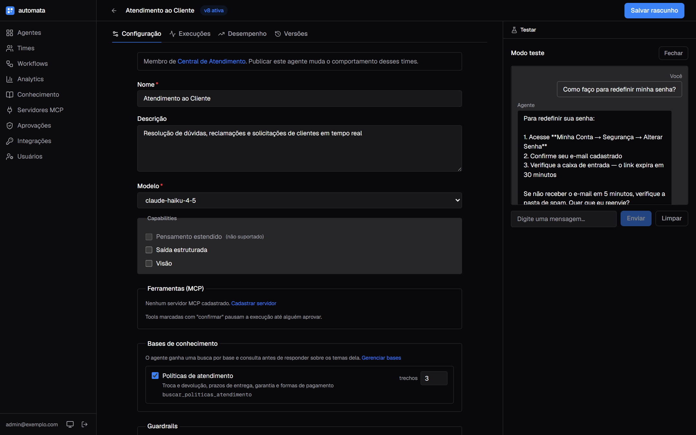
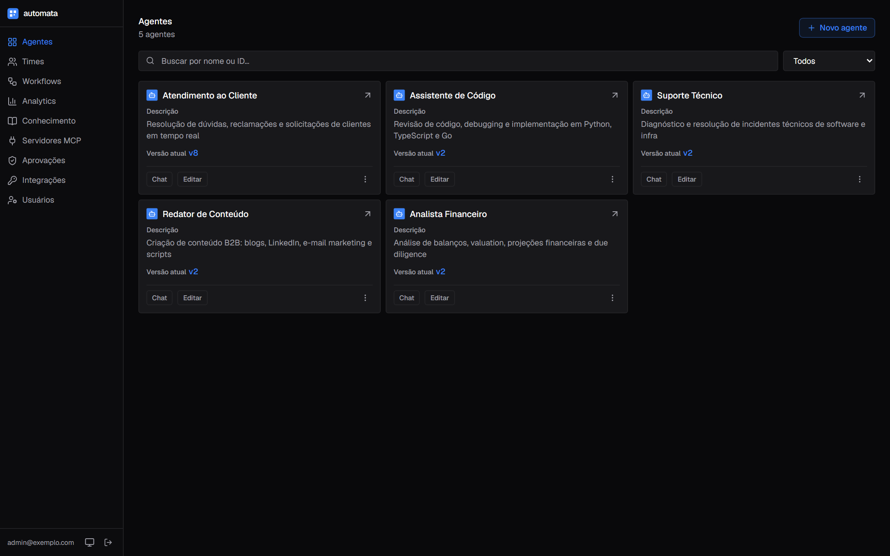
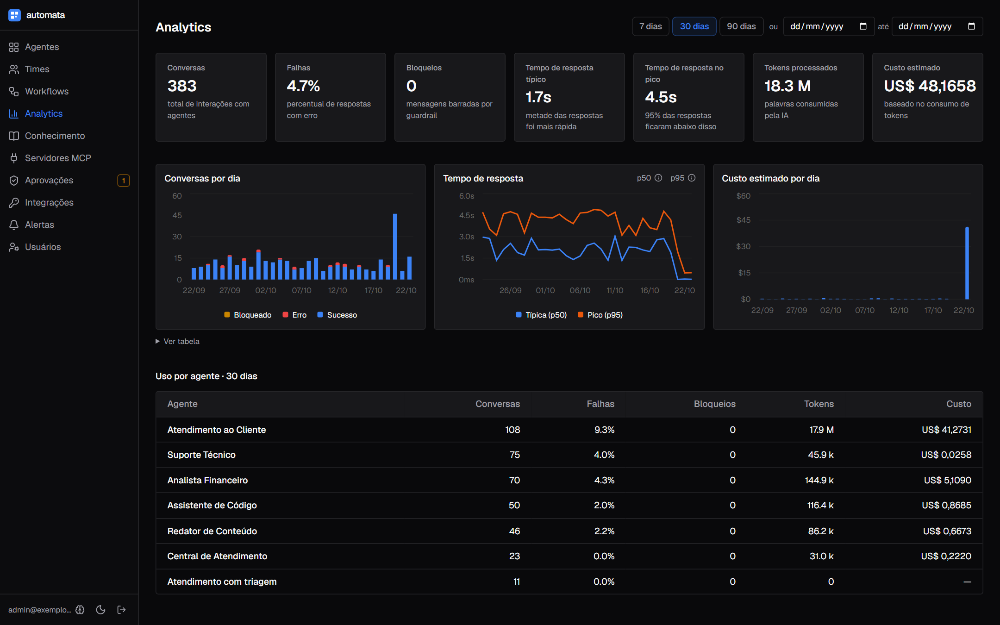

# Automata

[](https://github.com/WellCod/automata/actions/workflows/ci.yml)
[](https://github.com/WellCod/automata/actions/workflows/publish.yml)

Plataforma de operação de agentes de IA em produção — versionamento imutável de configuração, rollback em um clique, troca de modelo sem reescrita de prompt, estimativa de custo antes de publicar e painel analítico com latência p50/p95 por agente.

---

## O problema

Colocar um agente de IA em produção é simples. Operar quarenta, com equipes diferentes editando prompts, é outro problema.

**Prompt sem histórico.** Alguém ajusta uma instrução às 18h, a qualidade cai — e não há caminho de volta. O prompt estava num campo de texto que foi sobrescrito.

**Troca de modelo quebra comportamento silenciosamente.** Instruções acopladas a um provider específico (blocos de raciocínio, formato JSON sem markdown) degradam ao migrar de modelo sem gerar erro visível.

**Custo opaco até a fatura chegar.** Sem estimativa antes de publicar, um prompt de três mil tokens multiplicado pelo volume mensal pode estourar o contrato sem nenhum alerta.

**Configuração e prompt divergem.** O prompt menciona uma ferramenta que não está habilitada no agente. Isso não falha no deploy — falha na conversa com o usuário, dias depois.

Automata trata esses quatro problemas como requisito de produto, não como disciplina de quem edita.

---

## Telas

Painel rodando com o seed de demonstração — cinco agentes publicados e 500
execuções distribuídas em 90 dias, tudo sintético.

### Configuração do agente

Versão ativa marcada no topo, instruções em campos separados em vez de um
textão e linter junto da configuração. A página tem abas para Configuração,
Execuções, Desempenho (métricas e custo) e Versões; o modo teste fica fixo ao
lado, visível em qualquer aba.



### Agentes



### Analytics

Conversas, taxa de falha, latência típica e de pico, tokens e custo estimado,
com gráficos diários de conversas (sucesso e erro), tempo de resposta e custo.
A aba Desempenho de cada agente mostra os mesmos gráficos filtrados por ele.



---

## Demo

**Sem credencial de LLM.** O modo `DEMO_REPLAY=true` substitui o provider real por respostas pré-gravadas em `api/fixtures/`. Versionamento, rollback, modo teste e analytics funcionam completamente offline.

```bash
# 1. Sobe com replay
DEMO_REPLAY=true docker compose -f docker-compose.yml -f docker-compose.dev.yml up -d

# 2. Seed: owner + 5 agentes publicados + 500 runs históricos (90 dias)
# Defina a senha do owner — ela não fica escrita em lugar nenhum
read -rsp "Senha do owner: " SEED_OWNER_PASSWORD; echo

docker exec \
  -e SEED_OWNER_EMAIL="admin@exemplo.com" \
  -e SEED_OWNER_PASSWORD="$SEED_OWNER_PASSWORD" \
  automata-api-1 bash -c "cd /app && .venv/bin/python scripts/seed.py full"

# 3. Painel
pnpm --filter web dev   # http://localhost:3000
```

Login: o e-mail e a senha definidos no passo 2.

O seed `full` gera uma base de conhecimento de exemplo ligada ao agente de atendimento e 5 agentes com perfis distintos (Analista Financeiro em `claude-opus-4-7`, Redator em `claude-sonnet-4-6`, Atendimento e Suporte em `claude-haiku-4-5`, Assistente de Código em `claude-sonnet-4-6`) e distribui 500 execuções nos últimos 90 dias com latências, taxas de erro e custos proporcionais ao modelo de cada agente. O painel de analytics reflete dados realistas desde o primeiro acesso.

Guia completo em [`DEMO.md`](DEMO.md).


---

## O que está implementado

### Gestão de configuração

| Funcionalidade | Detalhe |
|---|---|
| **Versionamento imutável** | Publicar cria uma `AgentConfigVersion` e move um ponteiro. A versão anterior nunca é alterada. |
| **Rollback em um clique** | Mover o ponteiro para qualquer versão anterior — sem redeploy, sem reescrita. |
| **Diff visual entre versões** | Comparação lado a lado de instruções, modelo e capabilities entre versões. |
| **Factory por request** | O agente é reconstruído a partir da versão vigente em cada chamada — editar comportamento não exige redeploy. |
| **Modo teste** | Chat integrado no painel executa o agente na versão de rascunho, sem publicar. |

### Qualidade antes de publicar

| Funcionalidade | Detalhe |
|---|---|
| **Times multi-agente** | Um líder que coordena, roteia, consulta todos ou gerencia tarefas entre agentes publicados. O time é versionado como agente. O modo teste mostra o rastro da delegação: a quem o líder delegou e que tools o membro chamou ([ADR-0011](docs/adr/0011-times-versionados.md)). |
| **Ferramentas via MCP** | Catálogo de servidores MCP (`/mcp`) com credenciais cifradas e teste de conexão. Em cada agente, escolhe-se quais servidores e quais tools ele usa, e quais pedem confirmação. Servidor fora do ar faz o run falhar com o motivo, em vez de o agente responder sem as tools ([ADR-0010](docs/adr/0010-servidores-mcp-externos.md)). |
| **Bases de conhecimento (RAG)** | Página Conhecimento: bases com PDF, DOCX, Markdown, texto, CSV, JSON ou páginas web, enviados por arrastar e soltar, URL ou texto colado. Estado de cada documento (processando, trechos indexados, motivo da falha) e busca de teste que mostra os trechos que o agente receberia. No agente, escolhem-se as bases e quantos trechos por busca; o modo teste e a árvore de execução mostram os documentos consultados ([ADR-0012](docs/adr/0012-bases-de-conhecimento.md)). |
| **Usuários e papéis** | Página Usuários (só owner): criar com senha temporária, trocar papel (owner, editor, leitor), desativar, redefinir senha e remover. Mudanças encerram na hora as sessões abertas da pessoa. |
| **Tema claro e escuro** | Paleta grafite e azul, com claro, escuro ou o tema do sistema, escolhido no rodapé da sidebar e lembrado por navegador ([DESIGN.md](DESIGN.md)). |
| **Confirmação humana** | Tools sensíveis pausam a execução até alguém aprovar ou rejeitar, no modo teste ou na página Aprovações, com nome e argumentos da ação. |
| **Integrações** | Tokens por sistema consumidor, limitados aos agentes e times escolhidos, com validade e revogação imediata. O painel entrega a configuração pronta para Claude Desktop ou Cursor usarem os agentes via MCP. |
| **Árvore de execução** | Cada execução abre em árvore: time → agentes → chamadas de modelo e tools, com duração, entrada, saída e erro de cada etapa. |
| **Linter de prompt** | Detecta referências a ferramentas não habilitadas e termos acoplados a provider. Alerta inline na edição. |
| **Estimativa de custo** | Tokens estimados, custo por mensagem e projeção por volume — visíveis enquanto se edita. |
| **Capabilities condicionais** | Extended thinking, structured output e visão são habilitadas por modelo. O campo é desativado e explicado se o modelo escolhido não suportar. Extended thinking liga o `thinking` do Claude na execução. |
| **Validação na escrita** | Capabilities solicitadas mas não suportadas pelo modelo bloqueiam o save — não chegam a produção. |
| **Instructions agnósticas de provider** | Validação recusa instruções com termos acoplados a provider específico. Garantida por teste no CI ([ADR-0006](docs/adr/0006-instructions-agnosticas-de-provider.md)). |

### Observabilidade e analytics

| Funcionalidade | Detalhe |
|---|---|
| **Painel Analytics global** | Volume de runs, tokens consumidos, custo total e latência p50/p95 — com filtro por período e intervalo de datas customizado. |
| **Métricas por agente** | Tabela com distribuição de runs, latência mediana e taxa de erro por agente e modelo. |
| **Histórico de execuções** | Lista de runs com status, latência, tokens e custo por execução. Atualização em tempo real via SSE. |
| **Logging estruturado** | Todos os logs incluem `request_id` correlacionável. Formato JSON em produção. |
| **Health check com validação de banco** | `/api/v1/health` verifica conectividade real com o Postgres antes de responder `healthy`. |

### Segurança e autenticação

| Área | Implementação |
|---|---|
| **JWT RS256** | Chave privada gerada localmente via OpenSSL. Nunca enviada ao browser. |
| **BFF pattern** | Todos os requests ao AgentOS passam por Route Handlers server-side do Next.js. O token não toca o client-side. |
| **Papéis e scopes** | `owner`, `editor`, `viewer` — toda rota, do AgentOS e própria (`/api/v1`), exige scope; viewer só lê. Tabela em [`api/README.md`](api/README.md#scopes-jwt). |
| **Política de senha** | Comprimento mínimo, caracteres especiais, maiúscula e número — validados na API. |
| **Headers de segurança** | `X-Content-Type-Options`, `X-Frame-Options`, `Referrer-Policy`, `Permissions-Policy`. `Strict-Transport-Security` na API (também atrás de proxy TLS em `TRUSTED_PROXIES`) e no painel em produção. O painel envia `Content-Security-Policy` com `frame-ancestors 'none'` e `connect-src 'self'`. |
| **Superfície mínima** | `/docs`, `/redoc` e `/openapi.json` só com `APP_ENV=development`. Login com e-mail inexistente também roda argon2, para a latência não revelar contas. |
| **Rate limiting** | Distribuído via Redis — login limitado por e-mail e por IP; `X-Forwarded-For` só vale de proxy em `TRUSTED_PROXIES`. |
| **Secrets fora do bundle** | Teste no CI inspeciona o bundle compilado do Next.js à procura de padrões de chave. Build falha se encontrar. |

### Confiabilidade e performance

| Área | Implementação |
|---|---|
| **Pool de conexões compartilhado** | SQLAlchemy Engine criado uma vez e reusado. Configurado com `pool_size`, `max_overflow` e `pool_pre_ping`. |
| **Índices de banco** | `agent_run(agent_config_id, created_at)`, `agent_run(created_at)`, `agent_run(run_id)`, `usage_event(period, agent_config_id)` e `usage_event(created_at)` — cobrem o histórico por agente e o analytics global. |
| **Cache HTTP em capabilities** | Endpoint `/capabilities` retorna `Cache-Control: public, max-age=86400`. |
| **Agentes publicados sem restart** | Publicar registra o agente no AgentOS na hora; outros workers sincronizam em até 5 s. |
| **Execuções gravadas de verdade** | Sucesso, erro, cancelamento e pausa, com duração e consumo, inclusive em streaming. |

---

## Arquitetura

```
┌─────────────────────────────────────────────────────┐
│  web/  — Next.js 16, App Router, React 19           │
│  TypeScript strict · shadcn/ui · TanStack Query 5   │
│  Vitest · Playwright E2E · bundle secrets test       │
└──────────────────────────┬──────────────────────────┘
                           │  BFF: Route Handlers server-side
                           │  (JWT RS256 — chave privada nunca
                           │   sai do servidor)
┌──────────────────────────┴──────────────────────────┐
│  api/  — FastAPI, Python 3.12                       │
│  AgentConfigVersion · factory por request           │
│  linter · estimativa de custo · metering            │
│  JWT RS256 · scopes · migrations próprias           │
│  logging estruturado · health check · rate limit    │
└──────────────────────────┬──────────────────────────┘
                           │
┌──────────────────────────┴──────────────────────────┐
│  Agno 2.8.7 (AgentOS)                               │
│  REST · sessions · traces · scopes por endpoint     │
└──────────────────────────┬──────────────────────────┘
                           │
              ┌────────────┴────────────┐
         PostgreSQL 17              Redis
         (config + runs           (rate limiting
          + metering)              distribuído)
```

O agente não é um objeto estático em código. Ele é construído por request a partir da versão publicada da configuração — isso permite editar comportamento sem redeploy e executar qualquer versão histórica em modo teste.

---

## Stack

| Camada | Tecnologia |
|---|---|
| Runtime de agente | Agno 2.8.7 (AgentOS) — FastAPI integrado, JWT com scopes, traces e sessions persistidos |
| API | Python 3.12, `uv` — lockfile determinístico, mypy strict, ruff (E/F/I/UP/B/SIM) |
| Banco | PostgreSQL 17 com pgvector (imagem `pgvector/pgvector:pg17`), Alembic — migrations isoladas das tabelas do framework |
| RAG | Knowledge do Agno com PgVector, embeddings da Voyage (`voyage-3.5`) ou OpenAI ([ADR-0012](docs/adr/0012-bases-de-conhecimento.md)) |
| Cache / Rate limit | Redis — rate limiting distribuído com burst por IP |
| Painel | Next.js 16, TypeScript strict, Tailwind 4, shadcn/ui |
| Estado e fetch | TanStack Query 5, openapi-fetch — tipos gerados via openapi-typescript, nunca escritos à mão |
| Formulários | react-hook-form + zod — habilitação condicional de campos requer schema declarativo |
| Testes API | pytest + asyncio, testcontainers — integração sem mock de banco; evals do Agno nightly |
| Testes Web | Vitest + Testing Library, Playwright E2E — inclui teste de secrets no bundle compilado |
| CI/CD | GitHub Actions — cache de layers Docker, coverage gate 70%, publish para GHCR |

---

## Decisões de arquitetura

Cada decisão relevante está documentada em [`docs/adr/`](docs/adr/) com contexto, alternativas descartadas (e por quê) e o gatilho concreto que faria reverter. As mais relevantes para entender o desenho:

| ADR | Decisão |
|---|---|
| [ADR-0001](docs/adr/0001-monorepo.md) | Monorepo sem ferramenta de monorepo — `uv` e `pnpm` bastam para duas aplicações em linguagens diferentes |
| [ADR-0002](docs/adr/0002-config-em-banco-proprio.md) | Config em banco próprio — por que não usar o editor visual do framework como fonte da verdade |
| [ADR-0003](docs/adr/0003-single-tenant.md) | Deploy single-tenant — por que uma instância por cliente, e a assimetria que torna difícil desfazer |
| [ADR-0005](docs/adr/0005-auth-jwt-proprio.md) | Auth JWT RS256 próprio — a chave de assinatura nunca sai do servidor |
| [ADR-0006](docs/adr/0006-instructions-agnosticas-de-provider.md) | Instructions agnósticas de provider — a regra que sustenta a promessa de trocar modelo |
| [ADR-0009](docs/adr/0009-superficie-de-integracao.md) | REST e MCP server mode como superfície de integração — descrição de agente vira contrato |
| [ADR-0010](docs/adr/0010-servidores-mcp-externos.md) | Servidores MCP externos — cadastro não versionado, segredo cifrado, só HTTP e falha visível |
| [ADR-0011](docs/adr/0011-times-versionados.md) | Times multi-agente na mesma tabela de configs, com membros seguindo a versão vigente |
| [ADR-0012](docs/adr/0012-bases-de-conhecimento.md) | Bases de conhecimento (RAG) — cadastro não versionado, pgvector no Postgres existente e embeddings da Voyage |

---

## Testes

```bash
# API — suite completa (sem LLM real, usa testcontainers)
cd api && uv run pytest -m "not nightly"

# API — evals de confiabilidade com LLM real (nightly no CI)
cd api && uv run pytest -m nightly   # requer ANTHROPIC_API_KEY

# Web — unitários e de componente
pnpm --filter web test

# Web — E2E (fluxo: login → editar agente → publicar → rollback)
pnpm --filter web test:e2e
```

Coverage gate: 70% no CI. O build falha se cair abaixo.

---

## Rodando local

**Pré-requisitos:** Docker Desktop, Node.js 22+, pnpm 11+, Python 3.12+, `uv`, `openssl`

```bash
git clone https://github.com/WellCod/automata.git
cd automata
bash scripts/bootstrap.sh   # gera chaves RSA, cria .env, instala deps e sobe o banco
```

**Terminal 1 — API:**
```bash
docker compose -f docker-compose.yml -f docker-compose.dev.yml up
```

API disponível em `http://localhost:8000`. Migrations rodam automaticamente no boot. A porta 8000 só é publicada pelo override de dev; em `docker-compose.yml` (produção) e `docker-compose.demo.yml` a API fica só na rede do compose e o painel fala com ela por `http://api:8000`.

Painel em container, com hot-reload, em vez do terminal 2: `docker compose -f docker-compose.yml -f docker-compose.dev.yml --profile docker-web up`.

**Terminal 2 — Painel:**
```bash
pnpm --filter web dev   # http://localhost:3000
```

**Seed:**
```bash
# Mínimo: só cria o owner
# Defina a senha do owner — ela não fica escrita em lugar nenhum
read -rsp "Senha do owner: " SEED_OWNER_PASSWORD; echo

docker exec \
  -e SEED_OWNER_EMAIL="admin@exemplo.com" \
  -e SEED_OWNER_PASSWORD="$SEED_OWNER_PASSWORD" \
  automata-api-1 bash -c "cd /app && .venv/bin/python scripts/seed.py minimal"

# Demo completo: 5 agentes + 500 runs históricos
# Defina a senha do owner — ela não fica escrita em lugar nenhum
read -rsp "Senha do owner: " SEED_OWNER_PASSWORD; echo

docker exec \
  -e SEED_OWNER_EMAIL="admin@exemplo.com" \
  -e SEED_OWNER_PASSWORD="$SEED_OWNER_PASSWORD" \
  automata-api-1 bash -c "cd /app && .venv/bin/python scripts/seed.py full"
```

---

## Estrutura

```
api/
  app/          aplicação FastAPI
  alembic/      migrations do banco próprio
  fixtures/     respostas pré-gravadas para DEMO_REPLAY=true
  scripts/      seed (minimal|demo|full), export_openapi
  tests/        pytest: integração + evals nightly
web/
  src/app/      rotas e Route Handlers (BFF)
  src/components/
  src/lib/      client openapi-fetch, hooks, utils
docs/adr/       12 Architecture Decision Records
DEMO.md         guia de demo local sem credencial de LLM
```

---

## Licença

Ver [`LICENSE`](LICENSE). Justificativa em [ADR-0007](docs/adr/0007-licenciamento.md).

---

Construído sobre [Agno](https://github.com/agno-agi/agno). Nenhum dado de produção, prompt real ou identificação de cliente consta neste repositório.
