# Automata

[](https://github.com/WellCod/automata/actions/workflows/ci.yml)
[](https://github.com/WellCod/automata/actions/workflows/publish.yml)

Plataforma para operar agentes de IA em produção. Com ela, quem não programa cria, versiona, testa e publica agentes, times multi-agente e workflows. Também liga bases de conhecimento (RAG) que acompanham o GitHub, o S3 e o SharePoint, ferramentas via MCP, guardrails e memória do usuário entre conversas. Roda suítes de teste por agente, time e workflow antes de publicar e de forma agendada, pausa o workflow para aprovação humana onde for preciso e acompanha execução, latência e custo de cada um, com orçamento mensal e aviso no canal do time.

O runtime é o [Agno](https://github.com/agno-agi/agno) (AgentOS). O Automata é a camada de produto em volta: configuração versionada em banco próprio, validação antes de publicar, rastreamento de cada execução, segurança e painel.

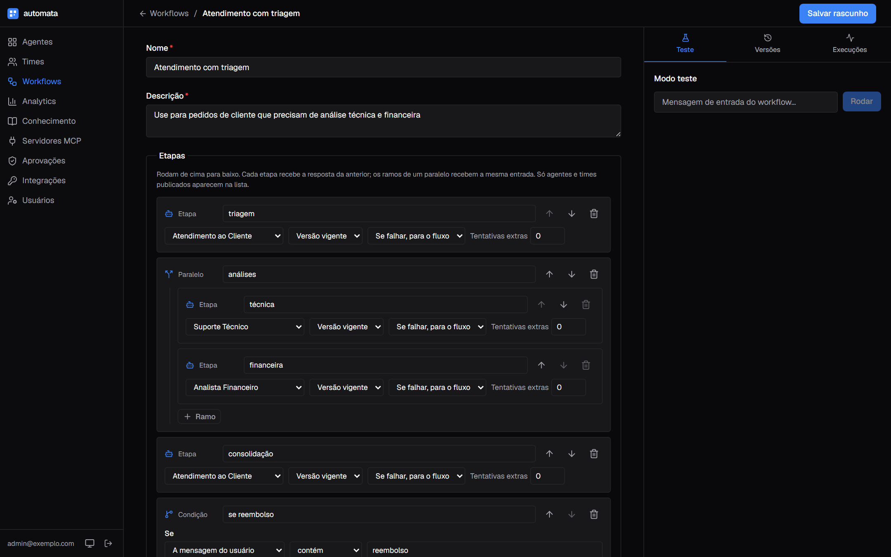

| | |
|---|---|
| **Backend** | Python 3.12 · FastAPI · Agno 3.1.8 · PostgreSQL 17 + pgvector · Redis · Alembic |
| **Frontend** | Next.js 16 · React 19 · TypeScript strict · Tailwind 4 · shadcn/ui · TanStack Query |
| **Qualidade** | mypy strict · ruff · ~630 testes pytest (testcontainers) · 158 testes Vitest · Playwright · evals |
| **Decisões** | 25 ADRs com contexto, alternativas descartadas e gatilho de reversão |

---

## Sumário

- [O problema](#o-problema)
- [O que a plataforma faz](#o-que-a-plataforma-faz)
- [Arquitetura](#arquitetura)
- [Como funciona por dentro](#como-funciona-por-dentro)
- [Segurança](#segurança)
- [Qualidade e testes](#qualidade-e-testes)
- [Decisões de arquitetura](#decisões-de-arquitetura)
- [Rodando local](#rodando-local)
- [Estrutura do repositório](#estrutura-do-repositório)

---

## O problema

Colocar um agente de IA em produção é simples. Operar quarenta, com equipes diferentes editando prompts, é outro problema:

- **Prompt sem histórico.** Alguém ajusta uma instrução às 18h, a qualidade cai e não há caminho de volta.
- **Troca de modelo quebra comportamento em silêncio.** Instruções acopladas a um provider degradam ao migrar de modelo sem gerar erro.
- **Custo opaco até a fatura chegar.** Sem estimativa antes de publicar, um prompt longo vezes o volume mensal estoura o orçamento.
- **Configuração e prompt divergem.** O prompt cita uma ferramenta que não está habilitada. Isso não falha no deploy, falha na conversa com o cliente.
- **Dado sensível e abuso.** CPF colado no chat vai para o provedor e para o log, e "ignore as instruções anteriores" funciona.

O Automata trata esses pontos como requisito de produto, não como disciplina de quem edita.

---

## O que a plataforma faz

### Agentes com versão, teste e rollback

Cada agente é uma configuração versionada: modelo, instruções em seções (persona, situação, tom, objetivo, limites), ferramentas, bases de conhecimento, guardrails e capabilities. Publicar cria uma versão imutável; rollback move um ponteiro. O modo teste roda a versão publicada ou o rascunho, sem publicar.


Antes de salvar, a API recusa o que quebraria em produção:
- capability que o modelo não suporta (pensamento estendido em modelo sem thinking);
- tool de servidor MCP que não existe mais;
- base de conhecimento apagada;
- instrução acoplada a um provider.

Enquanto se edita, o painel mostra o **linter de prompt** e a **estimativa de custo** por mensagem e por volume mensal.


### Times multi-agente

Um líder com modelo e instruções próprias coordena agentes publicados. Quatro modos, mapeados para o `TeamMode` do Agno:

| Modo | Como o líder trabalha |
|---|---|
| **Coordenar** | Divide a tarefa, delega a quem precisar e junta as respostas |
| **Rotear** | Escolhe um membro e devolve a resposta dele sem reescrever (handoff) |
| **Consultar todos** | A mesma tarefa vai a todos os membros, e o líder consolida |
| **Tarefas** | Monta uma lista de tarefas e acompanha até concluir |

A delegação é feita por tool call do próprio líder (`delegate_task_to_member`). A **descrição** de cada agente é o que o líder lê para decidir a quem passar o caso, por isso ela é obrigatória e aparece no painel como contrato. Cada membro segue a versão vigente ou fica fixado numa versão. O modo teste mostra o rastro: a quem o líder delegou e que tools o membro chamou.

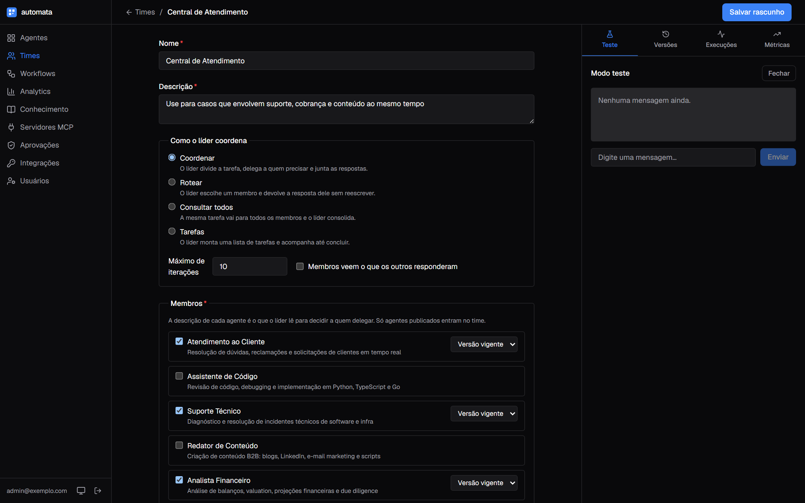

### Workflows por etapas

Quando o processo é conhecido e precisa ser repetível e auditável, um líder decidindo na hora não serve. O workflow é um fluxo fixo montado num editor visual sobre agentes e times publicados:

- **Etapa:** um agente ou time responde. Se falhar, para o fluxo ou segue, com até 3 tentativas.
- **Paralelo:** de 2 a 5 ramos recebem a mesma entrada ao mesmo tempo.
- **Condição:** regra sobre a mensagem do usuário ou a resposta anterior (contém, não contém, começa com, vazia), com então e senão.
- **Repetição:** limite de voltas e regra de parada ("até a revisão dizer *aprovado*").

O modo teste lê o stream do AgentOS e mostra cada etapa ao vivo: quem respondeu, o que respondeu, se a condição deu verdadeira, em que volta está a repetição e onde falhou. As execuções mostram o consumo somado de todas as etapas.

Uma etapa pode **pausar para revisão humana**: confirmar antes de rodar ou aprovar a saída antes da próxima etapa. A pendência aparece na página Aprovações e no próprio modo teste, com a saída a conferir. Recusar encerra o fluxo, pula a etapa ou a refaz com o motivo da recusa no contexto, e um prazo opcional cancela o que ficou parado.

<p align="center">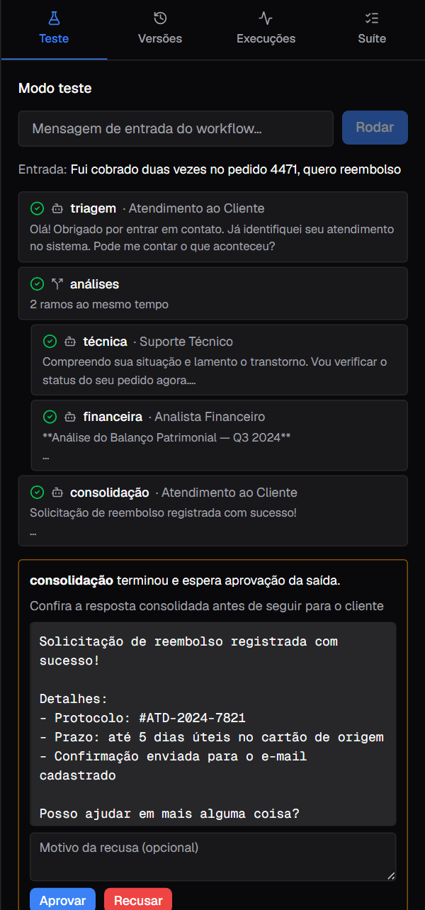</p>

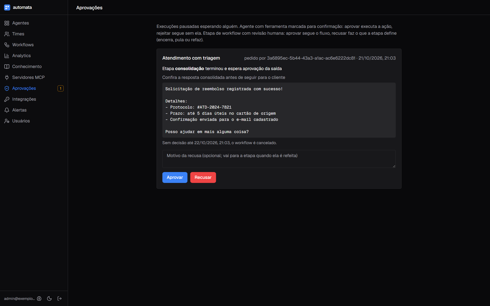

### Bases de conhecimento (RAG)

Bases com PDF, DOCX, Markdown, texto, CSV, JSON ou páginas web, enviados por arrastar e soltar, URL ou texto colado. O painel mostra o estado de cada documento (processando, trechos indexados, motivo da falha). A **busca de teste** mostra exatamente os trechos que o agente receberia para uma pergunta, sem rodar o agente.

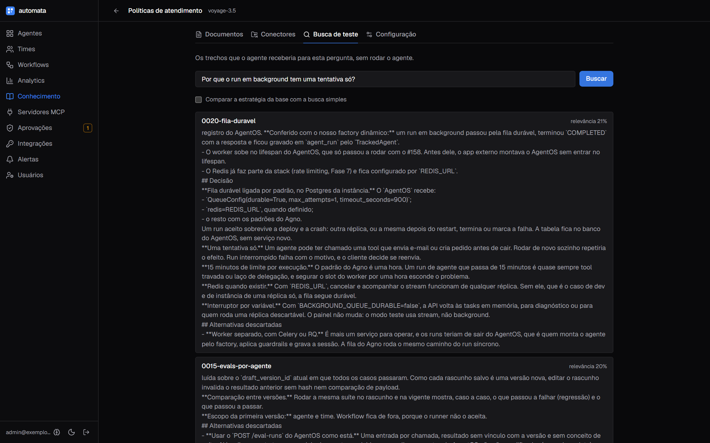

Cada base escolhe como buscar: a busca simples, diversidade (MMR, para manuais longos e documentos repetidos), recência (para políticas que mudam) e, opcionalmente, HyDE, que busca com uma resposta hipotética quando a pergunta não usa as palavras do documento. A busca de teste mostra lado a lado o resultado com a estratégia e sem ela, e os tokens que o HyDE gastou.

A base também acompanha a origem. Um **conector** lê um repositório do GitHub, um bucket S3 ou uma pasta do SharePoint, com a credencial cifrada. A sincronização compara pela versão de cada arquivo: arquivo novo entra, alterado é reindexado sem duplicar trecho, removido sai da base, e o que não mudou não é baixado nem cobra embedding. A sincronização pode rodar num intervalo, e uma URL pode ser baixada de novo todo dia ou toda semana, reindexando só se a página mudou.

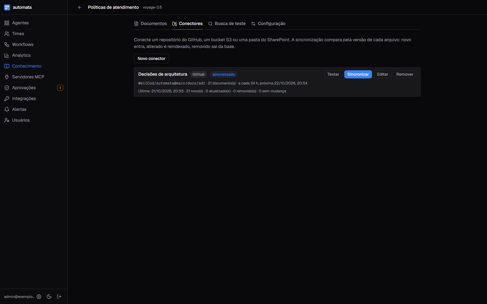

### Conversas longas

O agente lembra a conversa: leva ao modelo os últimos turnos da mesma sessão. Em atendimento longo, a **compactação** resume os turnos antigos quando a conversa passa de um limite em tokens. Assim, o número do pedido dito no começo continua chegando ao modelo, e o custo por turno fica limitado. A opção fica na versão do agente, desligada por padrão, com o que o resumo não pode perder escrito em português.

Entre conversas, a **memória do usuário** guarda o que a pessoa contou, como o tamanho que veste ou o horário que prefere para entrega. Cada agente só lê o que ele mesmo guardou, e só para o mesmo usuário. Documento, cartão, e-mail e telefone saem mascarados antes de gravar. Conversa sem usuário identificado não gera memória, e a memória vence depois do prazo de retenção. O owner apaga tudo de um usuário num agente, para atender pedido de exclusão, e cada usuário vê e apaga as próprias.

<p align="center">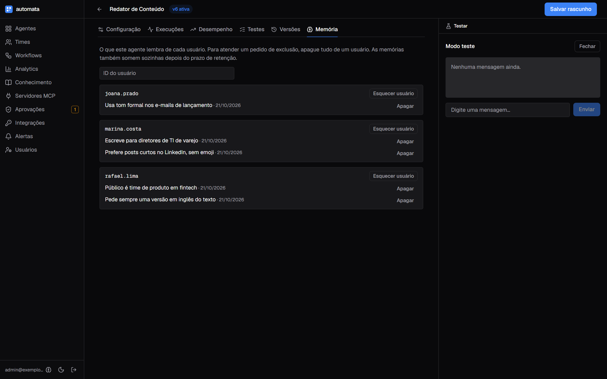</p>

### Guardrails por agente

Regras de entrada e saída versionadas junto com o agente. O bloqueio acontece antes da chamada ao modelo, então não gasta token.

- **Dados pessoais:** CPF e CNPJ com dígito verificador e cartão com Luhn, para que número de pedido não seja confundido com documento. Também e-mail e telefone. Cada tipo pode ser mascarado ou bloqueado.
- **Injeção de prompt:** detectada em português e inglês, sem diferenciar acento.
- **Outras regras:** tópicos proibidos, tamanho máximo e moderação opcional da OpenAI.
- **Na resposta:** dado pessoal ou termo proibido troca a resposta antes de ela sair.

Execuções barradas aparecem como **bloqueadas**, com a regra, separadas de falha no analytics.

<p align="center">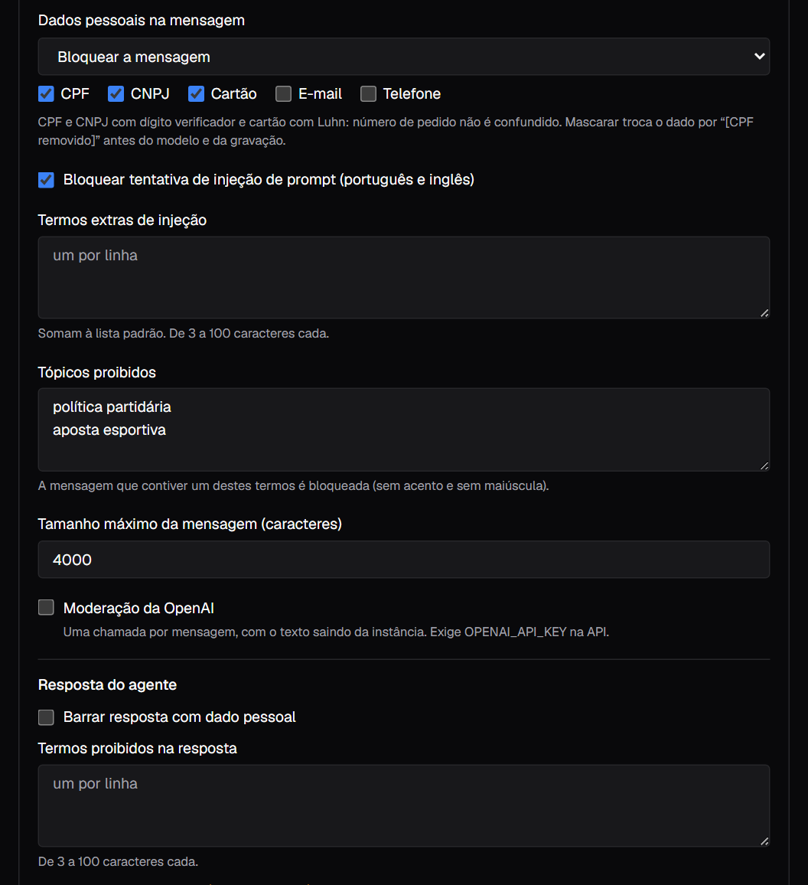</p>

### Testes por agente antes de publicar

Cada agente, time e workflow tem uma suíte de casos: uma mensagem e o que precisa ser verdade na resposta. As checagens são texto (contém, não contém, começa com), tools que precisam ser chamadas (a busca na base certa, a tool MCP esperada), um critério avaliado por um modelo juiz, binário ou nota com limiar, e o **bloqueio esperado**: o caso passa quando o guardrail barra a mensagem, pela regra certa. No workflow, a suíte confere também as **etapas que rodaram**, que é o que pega a condição que mudou de caminho. A suíte roda contra o rascunho ou a vigente, mostra o resultado caso a caso e compara as duas versões, apontando o que passou a falhar.

Com o **gate** ligado, publicar exige a suíte verde no rascunho atual. Editar o rascunho invalida o resultado. Os casos ficam fora da versão: um rascunho que muda o prompt não consegue afrouxar o próprio teste.

<p align="center">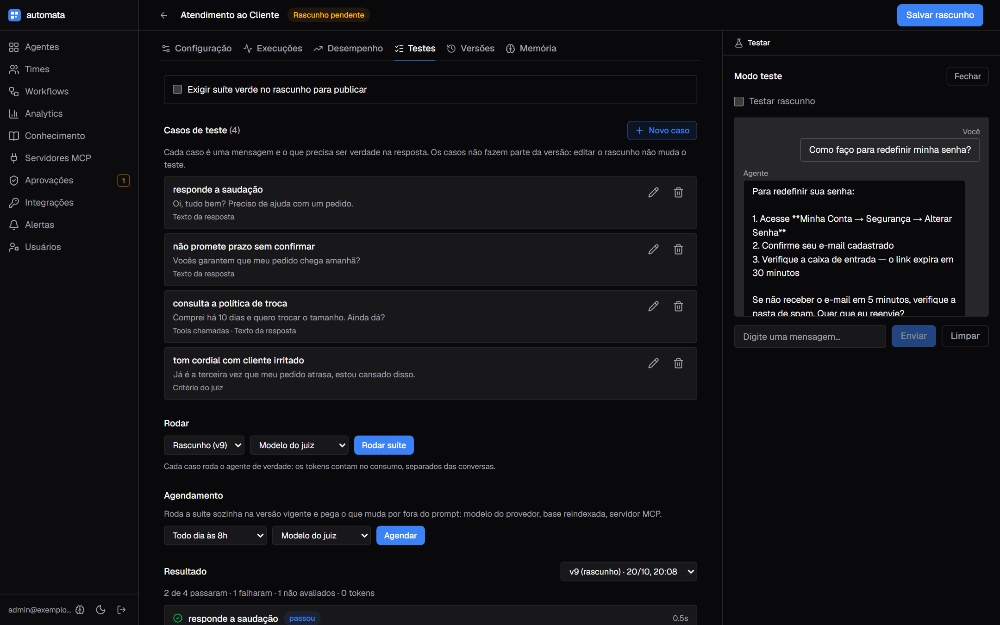</p>

A suíte também roda sem ninguém clicar. Um **agendamento** por agente roda a suíte na versão vigente e pega o que muda por fora do prompt: modelo do provedor, base reindexada, servidor MCP. A lista de agentes e times mostra o estado da suíte, e a execução agendada que perde um caso que passava aparece como regressão. O agendamento pode ter um **webhook**, que avisa o canal do time quando a suíte regride, passa a falhar ou volta a passar. Ele só dispara na mudança de estado, com assinatura HMAC e um texto pronto para Slack, Teams ou Discord. Um **token de integração** pode rodar e ler a suíte de agentes escolhidos, para o CI de quem consome o agente decidir pelo `verdict`.

Caso novo não precisa nascer do zero. No histórico de execuções, **Virar caso de teste** abre o formulário preenchido com a mensagem, os turnos anteriores como contexto e as tools que o run chamou. Dados pessoais chegam mascarados, e o editor revisa antes de salvar.

### Ferramentas via MCP e confirmação humana

Catálogo de servidores MCP externos, com credenciais cifradas e teste de conexão que descobre as tools. Em cada agente, escolhe-se quais tools ele usa e quais **pedem confirmação**. Uma tool sensível pausa a execução até alguém aprovar ou rejeitar, no modo teste ou na página Aprovações, vendo nome e argumentos da ação.

O caminho inverso também existe: os próprios agentes e times ficam expostos via **MCP server mode** para Claude Desktop, Cursor e outros sistemas, com tokens de integração limitados aos agentes escolhidos e revogáveis na hora. Por REST, um sistema pode pedir o run em **background**: o pedido entra numa fila durável no Postgres e sobrevive a deploy e a crash.

### Analytics e rastreamento

Conversas, taxa de falha, bloqueios, latência p50 e p95, tokens e custo, com gráficos diários e uso por agente. Cada execução abre como **árvore**, com time, agentes, chamadas de modelo e tools, e mostra duração, entrada, saída e erro de cada nó.

O custo sai da tabela de preços de cada modelo quando o provedor só informa tokens, que é o caso da Anthropic e da OpenAI. Cada agente pode ter um **orçamento mensal**, com aviso num percentual e, se ligado, bloqueio dos runs seguintes quando estoura, sem chamar o modelo. Os **destinos de aviso** da instância recebem orçamento perto do limite ou estourado, pico de erro e mudança de estado das suítes agendadas, assinados com HMAC e prontos para Slack, Teams ou Discord.

<p align="center">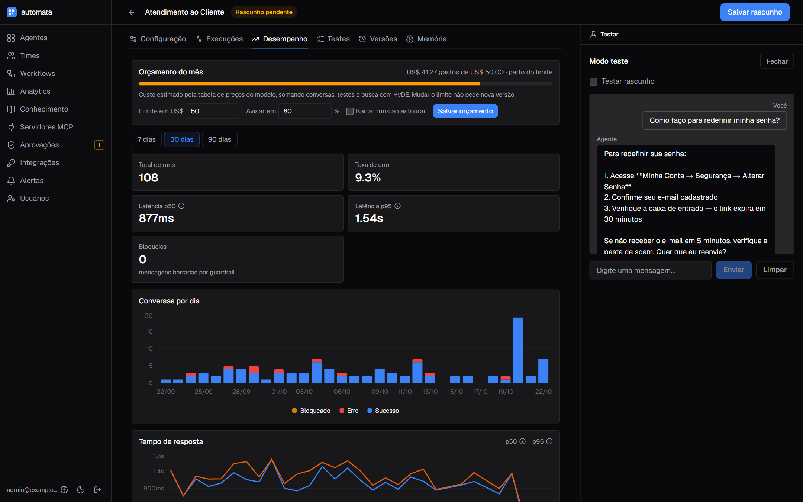</p>

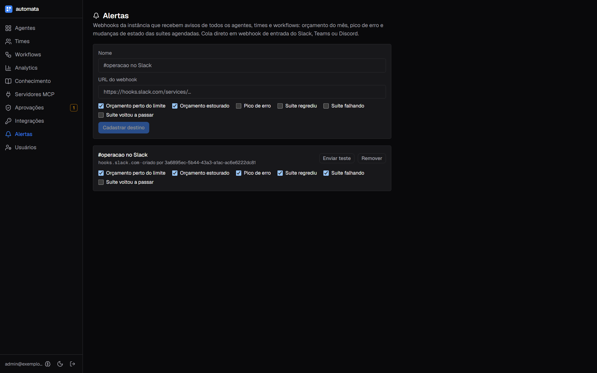


Tema claro e escuro, escolhido pelo usuário:

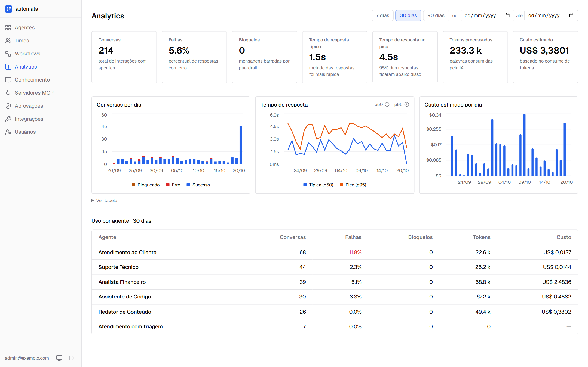

---

## Arquitetura

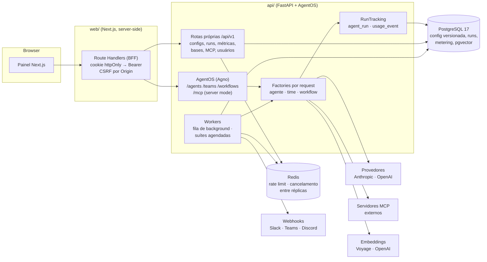

O painel nunca fala direto com a API: todo acesso passa por Route Handlers server-side, e o token fica num cookie httpOnly. A API tem dois lados. As rotas próprias, em `/api/v1`, gerenciam configuração, execuções, métricas, bases, servidores MCP e usuários. As rotas do AgentOS executam agentes, times e workflows; o Automata não as modifica, só registra nelas o que foi publicado. Dois laços rodam dentro da API, sem serviço à parte: o worker da fila de background, do próprio Agno, e o poller das suítes agendadas, que avisa por webhook quando o estado muda.

---

## Como funciona por dentro

### Configuração versionada e factory por request

`agent_config` guarda os ponteiros `current_version_id` e `draft_version_id`. `agent_config_version` guarda o payload em JSONB. Agente, time e workflow usam a mesma tabela, diferenciados por `kind`.

```text
rascunho ──publicar──▶ v3 (publicada, imutável) ◀── current_version_id
                       v2 (publicada)
                       v1 (publicada)            rollback = mover o ponteiro
```

- **Publicar nunca faz UPDATE.** Cria uma versão nova a partir do rascunho e move o ponteiro. Rollback só aceita versão publicada do mesmo config.
- **O payload tem `schema_version`.** Formatos antigos são convertidos na leitura, por um validator do pydantic, sem migração de dados.
- **O agente não é um objeto em código.** `AgentFactory`, `TeamFactory` e `WorkflowFactory` do Agno reconstroem tudo a cada request a partir da versão vigente: modelo, instruções, tools MCP, buscas nas bases e guardrails como `pre_hooks` e `post_hooks`. Com `version_id` no `factory_input`, a mesma factory roda um rascunho, que é como o modo teste funciona. A versão precisa pertencer ao config, senão um rascunho de B rodaria com o custo contado em A.
- **Publicar não exige restart.** O AgentOS lê listas mutáveis de agentes, times e workflows a cada request. Publicar registra a factory na hora, e outros workers sincronizam por um middleware com TTL de 5 s.
- **Memória da conversa.** O agente leva ao modelo os últimos 5 turnos da sessão, lidos do banco que o `AgentFactory` injeta. Com a compactação ligada na versão, a janela passa a ir até um limite de tokens (16 mil por padrão, contra 150 mil do Agno), e o que sobra vira um resumo feito pelo modelo do próprio agente. O consumo do resumo entra no run ([ADR-0019](docs/adr/0019-compactacao-de-conversa.md)).
- **Lifespan do AgentOS.** O AgentOS fica montado dentro do app que tem `/login` e `/health`, e o Starlette não roda lifespan de app montado. O app externo entra no lifespan do AgentOS de propósito: sem isso, o servidor MCP respondia 500 e o worker da fila não subia.

### Execução em background

Um run pedido com `background=true` vira uma linha na fila durável do Agno, no Postgres da instância ([ADR-0020](docs/adr/0020-fila-duravel.md)). Um worker por réplica reivindica a linha e roda o agente pelo mesmo factory dos runs síncronos.

- **Sobrevive a deploy.** Run aceito termina ou falha com motivo. Nunca fica `PENDING` para sempre.
- **Uma tentativa só.** O agente pode ter chamado uma tool com efeito antes de cair. Rodar de novo sozinho repetiria o efeito, então quem integra decide se reenvia.
- **15 minutos por execução** e 429 acima de mil pendentes.
- **Redis opcional.** Com `REDIS_URL`, cancelar e acompanhar o stream funcionam de qualquer réplica.

### Rastreamento e consumo

Hooks de pós-execução do Agno não rodam em erro nem em cancelamento. Por isso, o mixin `RunTracking` envolve `arun` e `acontinue_run`, nos modos coroutine e stream, e grava em `agent_run` (status, duração, erro, tools pendentes, regra de bloqueio) e em `usage_event` (tokens, custo, período) numa transação só.

- **Status:** `success`, `error`, `cancelled`, `paused` (aguardando confirmação humana) e `blocked` (guardrail).
- **Times:** só o run do time é gravado, porque o Agno já soma nele o consumo dos membros.
- **Workflows:** o `TrackedWorkflow` fixa o `run_id` antes de rodar e o publica numa `ContextVar`. Cada etapa grava esse id como `parent_run_id`, inclusive os ramos paralelos, que rodam em tasks que herdam o contexto. O consumo do workflow é a soma das etapas, e o analytics não conta nada duas vezes.

### Workflows

A árvore do payload (`step`, `parallel`, `condition`, `loop`) vira `Step`, `Parallel`, `Condition` e `Loop` do Agno, montados do zero a cada request. Três decisões saíram de comportamentos do Agno ([ADR-0014](docs/adr/0014-workflows-por-etapas.md)):

- **Uma instância nova por etapa.** Com a mesma instância, ramos paralelos compartilhariam estado e conexão MCP.
- **Etapa com erro levanta `StepFailed`.** No Agno, a etapa seguinte receberia a mensagem de erro como se fosse resposta. Com a exceção, `on_error` e `max_retries` passam a valer. Quando o fluxo para, o `TrackedWorkflow` converte a falha num run com status de erro, em vez do 500 que a rota devolveria.
- **Regras próprias em vez de CEL.** Sem o pacote `cel-python`, o Agno avalia toda expressão como `False` em silêncio. Além disso, expressão é linguagem de programação dentro de um painel para quem não programa. Depois de um paralelo, a regra lê a resposta do último ramo, não a frase-resumo que o Agno põe no lugar.

Limites validados na escrita: 3 níveis de aninhamento, 30 etapas, nomes únicos e o fluxo não termina num paralelo. Agente com tool de confirmação humana não entra em workflow, porque o fluxo não pausa no meio.

### RAG

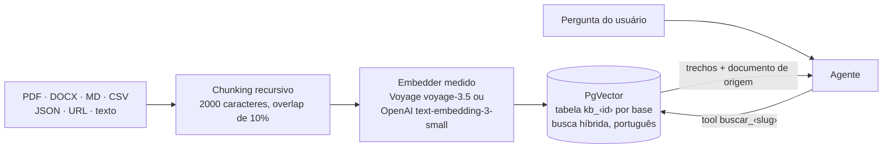

- **Pgvector no Postgres que já existe.** Cada base tem sua tabela vetorial, com dimensão fixada pelo embedder escolhido na criação, e busca híbrida (vetor + texto) configurada para português. Nada de serviço vetorial à parte ([ADR-0012](docs/adr/0012-bases-de-conhecimento.md)).
- **Ingestão em background.** O estado de cada documento fica em `knowledge_content`. O primeiro trecho é embedado antes do insert, para que chave inválida ou cota estourada vire mensagem de falha legível; depois do insert, os trechos são contados. Documento preso em "processando" por mais de 30 min vira falha no boot.
- **Uma tool por base.** O agente recebe `buscar_<slug>`, e a descrição da base diz quando usar. A tool devolve trechos com documento e fonte, e as instruções mandam citar o documento e tratar o trecho como **dado, não instrução**, uma defesa contra injeção vinda de documento.
- **Estratégia por base.** O reranker do Agno entra na nossa busca: MMR, para trechos relevantes e diferentes entre si, ou recência, pela data da linha. Com reranker, a busca pede um lote maior de candidatos e reordena contra a pergunta. O HyDE, opcional, busca com uma resposta hipotética escrita por um modelo escolhido na base, com os tokens gravados no consumo do agente que buscou ([ADR-0017](docs/adr/0017-estrategia-de-recuperacao.md)).
- **Custo de embedding no metering.** `MeteredEmbedder` conta tokens de ingestão e de busca, com um cache curto para não pagar duas vezes pela mesma consulta.
- **Demo sem chave.** No modo replay, um embedder local determinístico indexa e busca por palavra em comum.

### Evals por agente

Os casos viram `Case`s do runner de suíte do próprio Agno (`agno.eval.suite`), que roda um por vez com timeout e checa tools esperadas (`ReliabilityEval`), critério do juiz (`AgentAsJudgeEval`) e um `Scorer` próprio para as regras de texto ([ADR-0015](docs/adr/0015-evals-por-agente.md)).

- **Mesmo agente de produção.** Cada caso ganha uma instância nova, montada pela mesma factory dos runs reais a partir da versão testada: mesmas tools, bases e guardrails. A execução é em background, e cada resultado é gravado assim que o caso termina.
- **Runs de teste não são conversas.** Uma `ContextVar` marca `agent_run.eval_run_id` e `usage_event.eval_run_id`. Esses runs ficam fora do histórico, das aprovações e das métricas; o custo continua no metering, separado como custo de testes.
- **Juiz com modelo nosso e medido.** Sem modelo explícito, o Agno cairia num modelo da OpenAI. O modelo do juiz é escolhido entre os que têm saída estruturada e embrulhado num medidor que soma os tokens dele no consumo da execução. No modo demo, o juiz aparece como "não avaliado" em vez de fingir aprovação.
- **Gate sem hash.** Cada rascunho salvo já é uma versão nova, então o resultado vale para aquele `version_id` e nenhum outro. Caso não avaliado não conta como aprovado, e rollback segue livre.
- **Agendamento com poller próprio.** Um laço na API reivindica os agendamentos vencidos com `SELECT … FOR UPDATE SKIP LOCKED`, e duas réplicas não duplicam a execução. O scheduler do AgentOS ficou de fora: o token interno dele não cobre as rotas próprias ([ADR-0016](docs/adr/0016-evals-continuos.md)).
- **Caso com contexto.** Os turnos anteriores do caso rodam no `setup` do `Case`, na mesma sessão, e só a última resposta é checada. É o que permite transformar uma conversa real em caso, com dados pessoais mascarados.
- **Aviso só na mudança.** Depois de cada execução agendada, a API compara com a anterior e chama o webhook só quando a suíte regride, passa a falhar ou volta a passar. O corpo é assinado com HMAC ([ADR-0018](docs/adr/0018-avisos-de-regressao.md)).

### MCP

- **Cliente de servidores externos.** Só streamable-http. Os headers de autenticação ficam cifrados com Fernet. Há proteção contra SSRF: só https, DNS resolvido e IP privado, loopback e link-local recusados, salvo hosts liberados por variável. A conexão é estrita: servidor fora do ar faz o run falhar com o motivo, em vez de o agente responder sem as tools ([ADR-0010](docs/adr/0010-servidores-mcp-externos.md)).
- **Confirmação humana.** Tools marcadas viram `requires_confirmation_tools` no Agno. O run pausado guarda as tools pendentes em `agent_run.pending_tools`, aparece em Aprovações e continua pela rota de continue do AgentOS.
- **Server mode.** O próprio AgentOS expõe os agentes por MCP, autenticado com JWT RS256. Tokens de integração têm `jti`, escopo por agente ou time, validade de até 90 dias e revogação imediata ([ADR-0009](docs/adr/0009-superficie-de-integracao.md)).

---

## Segurança

| Área | Implementação |
|---|---|
| **JWT RS256** | A API assina com a chave privada, que nunca sai dela. O AgentOS valida com a pública e com `user_isolation`. O token expira em 1 h e leva `jti` e `kid`; na troca do par, a chave anterior segue aceita até os tokens vencerem ([ADR-0026](docs/adr/0026-rotacao-de-chaves.md)). |
| **BFF** | Cookie httpOnly e `sameSite=lax`, `secure` em produção. O proxy server-side converte o cookie em `Authorization: Bearer` e limpa a sessão no 401. Nenhum segredo vai para o bundle, e um teste no CI procura chaves no build. |
| **CSRF** | `Origin` conferido contra `Host` em todo método que não é seguro. |
| **Revogação** | Logout revoga o `jti`. Mudar papel, desativar ou trocar senha corta na hora as sessões da pessoa. |
| **Papéis e scopes** | `owner`, `editor`, `viewer`. Toda rota, própria ou do AgentOS, exige scope. |
| **Rate limit** | Login limitado por e-mail e IP, por e-mail e por IP no Redis, sem deixar ninguém travar a conta de outro. `X-Forwarded-For` só vale vindo de proxy listado em `TRUSTED_PROXIES`, e o painel só repassa o IP do cabeçalho de `CLIENT_IP_HEADER`. Busca de teste na base limitada por usuário. |
| **Superfície** | Login com e-mail inexistente também roda argon2, para a latência não revelar contas. `/docs` e `/openapi.json` só em desenvolvimento. |
| **Headers** | HSTS, CSP com `frame-ancestors 'none'`, `nosniff`, `Referrer-Policy`. |
| **Saída** | Servidores MCP, webhooks, destinos de aviso e conectores de conhecimento passam pelo mesmo filtro: só https, sem host que resolva para IP interno, conferido no cadastro e a cada chamada, sem seguir redirect. URLs e segredos ficam cifrados com Fernet. A telemetria do Agno fica desligada. |
| **Integrações** | Token de consumidor com escopo por recurso: roda só os agentes liberados e, se marcado, a suíte de testes deles, sem acesso a configuração. |
| **Troca de chaves** | A chave JWT e a chave dos segredos aceitam uma anterior só para ler durante a troca, e um comando recifra os segredos. A página Chaves mostra ao owner os tokens de integração e os segredos que ainda dependem da chave velha. Integrações marca esses tokens. Passo a passo em [docs/rotacao-de-chaves.md](docs/rotacao-de-chaves.md) ([ADR-0026](docs/adr/0026-rotacao-de-chaves.md)). |
| **Dado pessoal** | Memória do usuário mascarada antes de gravar, lida só pelo agente que guardou, com retenção e exclusão pelo owner e pelo próprio usuário. Credencial de conector e memórias de usuários finais são só do owner. |

---

## Qualidade e testes

| Camada | Ferramenta | Cobertura |
|---|---|---|
| API | pytest + testcontainers | ~630 testes contra Postgres com pgvector real, sem mock de banco. Gate de cobertura de 70%. |
| Tipos | mypy strict + plugin pydantic · ruff | Rodam em todo PR. |
| Web | Vitest + Testing Library | 158 testes de componente e de lógica, inclusive o redutor de eventos do workflow, a suíte de testes e a revisão humana. |
| E2E | Playwright | Login → editar agente → publicar → rollback. |
| Contrato | openapi-typescript | Os tipos do painel são gerados do OpenAPI da API, nunca escritos à mão. |

**Evals** medem o comportamento que importa, não só se o código roda:

| Eval | O que mede | Quando roda |
|---|---|---|
| Guardrails | 30 mensagens com a regra que deveria barrar cada uma ou nenhuma. Um terço são casos legítimos (número de pedido, "política de reembolso") que precisam passar. | Todo PR |
| Workflows | Regras sobre respostas reais de triagem, inclusive os limites documentados (negação, flexão), condição depois de paralelo e estrutura aceita ou recusada. | Todo PR |
| Suíte de testes | Scorer de texto sobre respostas reais, montagem do `Case` do Agno (juiz só com modelo, nunca no modo demo), tradução do resultado do runner, veredito do gate (não avaliado trava) e comparação entre execuções. | Todo PR |
| Evals contínuos | Validação do agendamento (cron, fuso, intervalo mínimo de 1 hora), próximo horário no fuso certo, escopo por recurso dos tokens de integração, `verdict` que o pipeline lê e montagem da sugestão de caso (máscara, tools com erro fora). | Todo PR |
| Avisos de regressão | Transições que avisam e as que ficam em silêncio (falha seguida de falha, verde seguido de verde), assinatura HMAC conferida pelo receptor e corpo com `text` e `content`. | Todo PR |
| Compactação | Versão sem a seção fica sem compactação, limite e turnos passados ao Agno, resumo pelo modelo do agente e limites recusados. O ponta a ponta, com o resumo chegando ao modelo acima do limite, roda na suíte de runtime. | Todo PR |
| Recuperação | O documento certo volta entre os 3 primeiros trechos. A versão literal roda em todo PR com cada estratégia de busca (simples, MMR, recência), e nenhuma pode errar. A semântica, com Voyage, roda à noite, aceita recall@3 de 80% e compara as estratégias (HyDE incluso, com chave de modelo) com a busca simples. | PR e noturna |
| Confiabilidade | Tool calls com LLM real. | Noturna |

**CI** (GitHub Actions): filtro por caminho, jobs de API, web e e2e, montagem das imagens de produção da API e do painel e um gate que falha se qualquer um falhar. Tag `v*` publica as imagens no GHCR e anexa o `openapi.json` na release.

---

## Decisões de arquitetura

Cada decisão relevante está em [`docs/adr/`](docs/adr/), com contexto, alternativas descartadas e o gatilho concreto que faria reverter.

| ADR | Decisão |
|---|---|
| [0001](docs/adr/0001-monorepo.md) | Monorepo sem ferramenta de monorepo: `uv` e `pnpm` bastam |
| [0002](docs/adr/0002-config-em-banco-proprio.md) | Configuração em banco próprio, não no editor do framework |
| [0003](docs/adr/0003-single-tenant.md) | Uma instância por cliente, e a assimetria que torna difícil desfazer |
| [0004](docs/adr/0004-painel-proprio.md) | Painel próprio; o Control Plane do Agno só como ferramenta interna |
| [0005](docs/adr/0005-auth-jwt-proprio.md) | JWT RS256 próprio; a chave de assinatura nunca sai do servidor |
| [0006](docs/adr/0006-instructions-agnosticas-de-provider.md) | Instruções sem termos de provider, a regra que sustenta trocar de modelo |
| [0007](docs/adr/0007-licenciamento.md) | Código aberto sob AGPL-3.0 com licença comercial paralela |
| [0008](docs/adr/0008-demo-com-respostas-gravadas.md) | Demo pública com respostas gravadas, sem chave de LLM |
| [0009](docs/adr/0009-superficie-de-integracao.md) | REST e MCP server mode como superfície de integração |
| [0010](docs/adr/0010-servidores-mcp-externos.md) | Servidores MCP externos: segredo cifrado, só HTTP, falha visível |
| [0011](docs/adr/0011-times-versionados.md) | Times na mesma tabela de configs, membros seguindo a versão vigente |
| [0012](docs/adr/0012-bases-de-conhecimento.md) | RAG com pgvector no Postgres existente e embeddings da Voyage |
| [0013](docs/adr/0013-guardrails-por-agente.md) | Guardrails versionados com o agente, bloqueio sem custo de modelo |
| [0014](docs/adr/0014-workflows-por-etapas.md) | Workflows por etapas com regras sem CEL e etapa com erro que para o fluxo |
| [0015](docs/adr/0015-evals-por-agente.md) | Evals por agente no painel: casos fora da versão, runner de suíte do Agno e gate de publicação |
| [0016](docs/adr/0016-evals-continuos.md) | Evals contínuos: suíte por token de integração, agendamento próprio e casos de conversas reais |
| [0017](docs/adr/0017-estrategia-de-recuperacao.md) | Estratégia de recuperação por base: reranker do Agno (MMR, recência) e HyDE com modelo medido |
| [0018](docs/adr/0018-avisos-de-regressao.md) | Avisos de regressão por webhook assinado nas mudanças de estado da suíte agendada |
| [0019](docs/adr/0019-compactacao-de-conversa.md) | Compactação de conversa por agente no payload versionado, limite de 16 mil tokens |
| [0020](docs/adr/0020-fila-duravel.md) | Fila durável para runs em background, uma tentativa e 15 min por execução |
| [0021](docs/adr/0021-orcamento-e-alertas.md) | Custo estimado pela tabela de preços, orçamento mensal com bloqueio e destinos de aviso |
| [0022](docs/adr/0022-suite-de-workflow-e-bloqueio.md) | Suíte de testes para workflows e caso que espera bloqueio de guardrail |
| [0023](docs/adr/0023-revisao-humana-no-workflow.md) | Revisão humana numa etapa do workflow, antes de rodar ou depois da saída |
| [0024](docs/adr/0024-conectores-de-conhecimento.md) | Conectores de conhecimento (GitHub, S3, SharePoint) e reindexação agendada |
| [0025](docs/adr/0025-memoria-do-usuario.md) | Memória do usuário entre sessões, por agente, com retenção, PII mascarado e exclusão |
| [0026](docs/adr/0026-rotacao-de-chaves.md) | Rotação da chave JWT e da chave dos segredos sem derrubar sessões nem integrações (proposto, Fase 27) |

O histórico de fases, com os problemas encontrados em auditoria e o critério de aceite de cada uma, está em [`docs/roadmap.md`](docs/roadmap.md).

---

## Rodando local

**Pré-requisitos:** Docker Desktop, Node.js 22+, pnpm, Python 3.12+, `uv` e `openssl`.

```bash
git clone https://github.com/WellCod/automata.git
cd automata
bash scripts/bootstrap.sh   # gera chaves RSA, cria .env, instala dependências e sobe o banco
```

### Demo sem chave de LLM

Com `DEMO_REPLAY=true`, o modelo é trocado por respostas gravadas em `api/fixtures/` e as bases usam um embedder local. Edição, versões, modo teste, workflows e analytics funcionam sem chave nenhuma.

```bash
# API em modo replay (--build -V recria imagem e venv se as dependências mudaram)
DEMO_REPLAY=true docker compose -f docker-compose.yml -f docker-compose.dev.yml up -d --build -V

# Seed: owner, 5 agentes, base de conhecimento, workflow, suíte de testes e 500 execuções em 90 dias
read -rsp "Senha do owner: " SEED_OWNER_PASSWORD; echo
docker exec \
  -e SEED_OWNER_EMAIL="admin@exemplo.com" \
  -e SEED_OWNER_PASSWORD="$SEED_OWNER_PASSWORD" \
  automata-api-1 bash -c "cd /app && .venv/bin/python scripts/seed.py full"

# Painel
pnpm --filter web dev   # http://localhost:3000
```

Guia completo, com o que o seed cria e como as fixtures funcionam, em [`DEMO.md`](DEMO.md).

### Desenvolvimento

```bash
docker compose -f docker-compose.yml -f docker-compose.dev.yml up   # API em :8000, migrations no boot
pnpm --filter web dev                                                 # painel em :3000
```

A porta 8000 só é publicada pelo override de dev. Em produção, a API fica na rede do compose e o painel fala com ela por `http://api:8000`. Depois de um `git pull` que mexa em `api/uv.lock`, recrie a API com `--build -V`. Sem o `-V`, o volume anônimo do venv mantém as dependências antigas.

### Testes

```bash
cd api && uv run pytest -m "not nightly"   # API, com testcontainers
cd api && uv run pytest -m nightly         # evals com LLM real (ANTHROPIC_API_KEY)
pnpm --filter web test                     # Vitest
pnpm --filter web test:e2e                 # Playwright
```

---

## Estrutura do repositório

```
api/
  app/
    agents/       factories, rastreamento, workflows, modelos, memória do usuário, replay
    evals/        runner da suíte (agente, time e workflow), juiz, gate, agendamento, avisos e sugestão de caso
    guardrails/   regras de entrada e saída
    knowledge/    embedders, ingestão, conectores, reindexação agendada, busca com reranker e HyDE, tools
    mcp/          cliente MCP, proteção de saída (SSRF)
    routers/      rotas próprias /api/v1
    services/     regras de negócio e validação na escrita
  alembic/        34 migrations
  fixtures/       respostas gravadas do modo replay
  tests/          pytest, integração e evals
web/
  src/app/        páginas e Route Handlers (BFF)
  src/components/ editor de workflow, suíte de testes, modo teste, painéis
  src/lib/        client gerado do OpenAPI, SSE, progresso do workflow
  e2e/            Playwright
docs/
  adr/            25 Architecture Decision Records
  roadmap.md      fases, auditorias e critérios de aceite
DESIGN.md         sistema visual do painel
DEMO.md           demo local sem chave de LLM
```

---

## Licença

Ver [`LICENSE`](LICENSE). Justificativa em [ADR-0007](docs/adr/0007-licenciamento.md).

Construído sobre o [Agno](https://github.com/agno-agi/agno). Nenhum dado de produção, prompt real ou identificação de cliente consta neste repositório; os prints usam o seed de demonstração.
